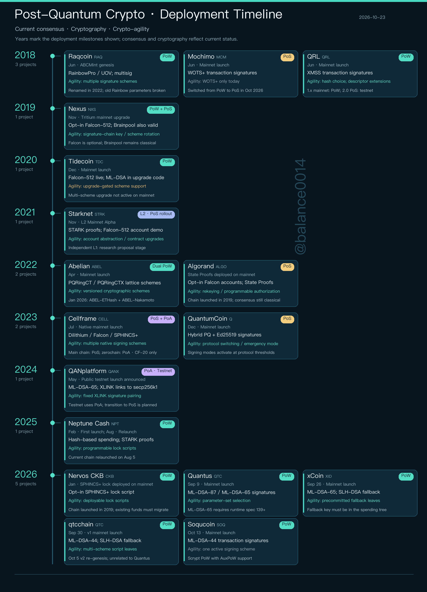
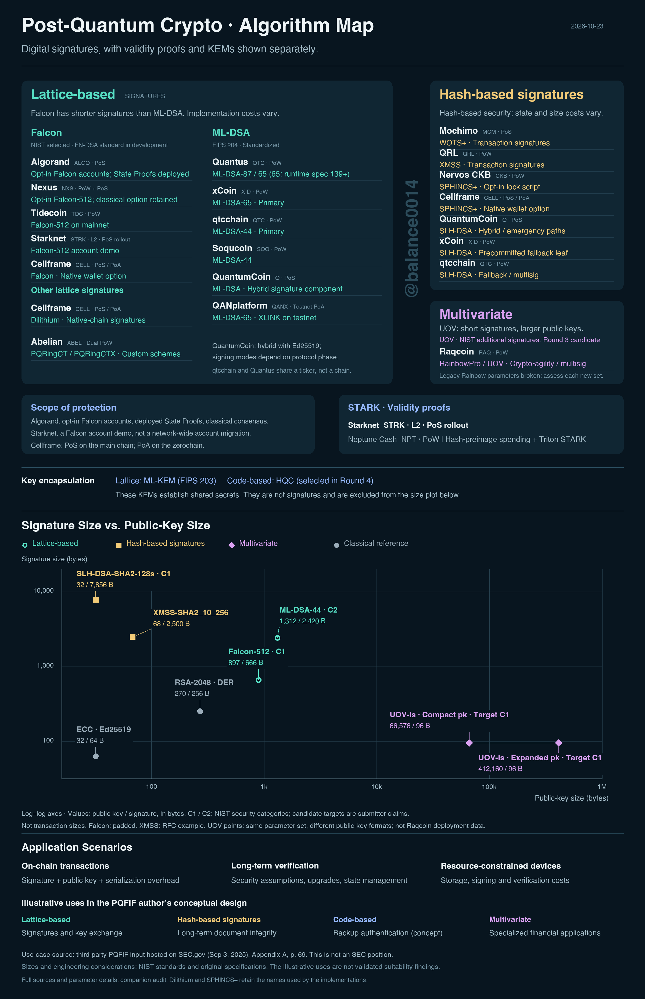

# Post-Quantum Crypto Map

**Which blockchains actually use post-quantum signatures, and where.** 17 projects, every claim linked to a source.

[Browse the projects](docs/projects.md) · [Compare signature sizes](docs/signature-sizes.md) · [Download CSV](data/projects.csv) · [Report a correction](https://github.com/Balance0014/post-quantum-crypto-map/issues/new/choose) · [中文](README.zh-CN.md)

As of October 23, 2026:

- **12 of the 17** use a post-quantum scheme on their default transaction path.
- **4** offer it only as an opt-in account, lock or demo: Nexus, Starknet, Algorand and Nervos CKB.
- **1** is testnet-only: QANplatform.

It started as two maps I posted on [X](https://x.com/balance0014). This is the data behind them, so you can check my work and tell me what I got wrong. The data is a snapshot from the day the charts went up; I published it on October 28 after [a few re-checks](docs/release-review.md). It isn't a live feed or a security ranking.

Maintained by Balance Zhao ([@balance0014](https://x.com/balance0014)).

## The two maps

### Deployment timeline

Each card's year is the milestone written on it: a chain launch, a later cryptographic upgrade, or a public testnet. It doesn't mean every feature on the card existed that year. [Full-resolution PNG](charts/deployment-timeline-2026-10-23.png).



### Algorithm map

A project can sit under more than one scheme, and opt-in features, fallbacks, testnets and demos are labeled. STARK proofs and key-encapsulation mechanisms are shown apart because they don't sign transactions. [Full-resolution PNG](charts/algorithm-map-2026-10-23.png).



## Easy to misread

- **Mochimo** is recorded as PoS, after its October 2026 switch. It ran PoW before that.
- **QANplatform:** the QANX token trades, but QAN's post-quantum chain is still a testnet.
- **Starknet:** the 2021 milestone is L2 Mainnet Alpha. The vote on becoming an independent L1 backed research; it didn't approve leaving Ethereum.
- **Raqcoin:** 2018 is when its predecessor ABCMint launched, not when UOV was added. ABCMint's original Rainbow parameters are publicly broken. Raqcoin's guide still lists a Rainbow configuration (274) as the default, and this repo hasn't analyzed that configuration.
- **Quantus and qtcchain** both use the ticker QTC. They're different chains, so go by the project ID and the sources.

## What the data covers

An opt-in post-quantum lock only protects coins you move into it. Old accounts, consensus keys and bridges stay as they were.

The size table gives raw public-key and signature bytes for specific parameter sets. Those aren't transaction sizes, fees or a security ranking, and the UOV rows aren't measurements of Raqcoin transactions.

When a claim cites the project's own documentation, read it as "the project says so", not as an audit. 19 of the 81 sources are pinned to a specific commit; project web pages can change or disappear.

This is a selected comparison, not a list of every post-quantum project. The projects are the ones on the original maps plus those readers asked about; [methodology](docs/methodology.md) sets the minimum evidence bar.

## Reuse or contribute

Download the data, cite the snapshot date and link back here. If you change it, say what changed. Data, charts and prose are **CC BY 4.0**; scripts are **MIT**. Linked third-party material keeps its own terms. See [LICENSE](LICENSE).

To correct something, send the specific claim, a primary source and the network or version it applies to. Project teams are welcome; changes go through the same evidence check. [Open a correction or project request](https://github.com/Balance0014/post-quantum-crypto-map/issues/new/choose).

The scripts need Python 3.10+ and nothing else (CI runs 3.12):

```sh
python3 scripts/validate.py   # checks the files agree: IDs, link format, checksums, exports
python3 scripts/export.py     # rebuilds the readable tables and CSVs
```

`validate.py` doesn't fetch the links or re-check claims; it catches mismatches between files. The original PNGs are release artifacts, and the export script doesn't redraw them.

[Follow the research on X](https://x.com/balance0014) · [Changelog](CHANGELOG.md) · [How to cite](CITATION.cff)
